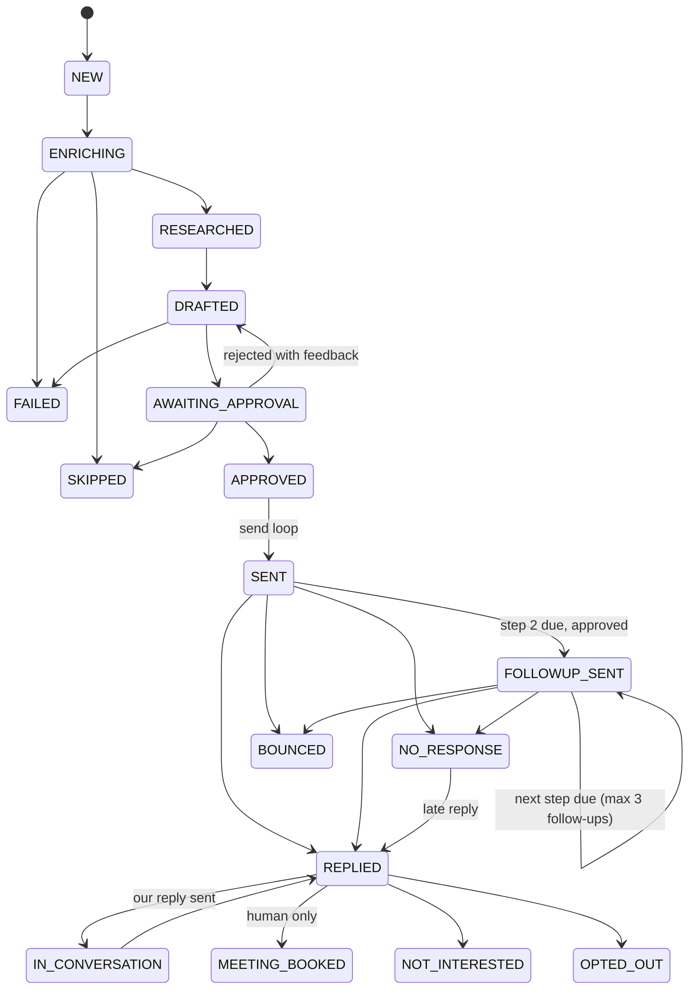
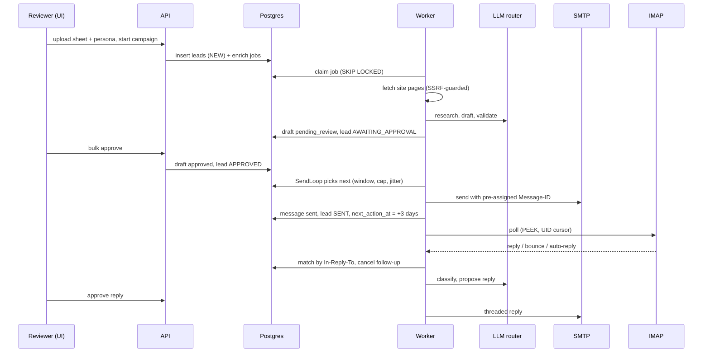

# Target Architecture — Outreach Platform v2

Status: **proposed v1.0** (8 Oct 2026). Goes into the repo as `docs/ARCHITECTURE_TARGET.md`. Claude Code treats it as authoritative; any deviation needs an ADR in `docs/DECISIONS.md`.

Tags used below: **[LOCKED]** = you decided it. **[DEFAULT]** = my choice, change via ADR. **[VERIFIED]** = checked against the vendor's docs on 8 Oct 2026. **[VERIFY]** = re-check before relying on it.

---

## 1. Goals, constraints, non-goals

**Goal.** A production system that takes a sheet of founders, researches each company and person from real sources, drafts a grounded email, gets human approval, sends it on a safe schedule, then handles replies, bounces, opt-outs and follow-ups until each lead reaches a terminal state. General purpose: each campaign carries its own persona and goal.

**Constraints [LOCKED].** Free-first (pay only when necessary). One business mailbox today over SMTP/IMAP, but built multi-org from day one. India-only B2B audience. 100 emails/day cap, Mon–Fri only, IST window, a configurable sequence of up to 3 follow-ups (default: one, 3 days after the first email). Groq to start. Human approves everything at launch.

**Non-goals for v1 [DEFAULT].** Open/click tracking (hurts deliverability and privacy), LinkedIn scraping or automation, auto-send without review, multi-mailbox rotation, A/B testing, CRM sync, scraping JavaScript-rendered sites with a headless browser.

---

## 2. System context

```
                            ┌──────────── Cloudflare Pages ────────────┐
 Reviewer / admin  ────────►│  React SPA (static build)                │
 browser                    └───────────────┬──────────────────────────┘
      │ login                               │ HTTPS, Bearer JWT
      ▼                                     ▼
 Supabase Auth ──(JWKS)──►  ┌───────────── Always-on VM (Docker Compose) ───────────────────┐
 (email+password)           │  Caddy (TLS)  ──►  api  (FastAPI, stateless)                    │
                            │                                                                 │
                            │  worker (one asyncio process)                                   │
                            │   ├─ JobRunner   research / draft / validate / classify / ...   │
                            │   ├─ SendLoop    the ONLY code that sends mail (rate-limited)   │
                            │   ├─ ImapLoop    poll, parse, match replies/bounces             │
                            │   └─ Scheduler   follow-ups, reaper, heartbeat, retention       │
                            └──────┬───────────────┬──────────────┬──────────────┬───────────┘
                                   ▼               ▼              ▼              ▼
                           Supabase Postgres   LLM providers   Public web     Business mailbox
                           (schema `app`,      (Groq, Cerebras  (target sites, SMTP :587 STARTTLS
                            Data API OFF)       OpenRouter, ..)  Tavily search) IMAP :993 TLS
```

Everything durable lives in Postgres. The api and worker hold no state that matters; killing either at any moment must lose nothing and duplicate nothing.

---

## 3. Deployment topology

| Piece | Where | Why |
|---|---|---|
| Frontend | **Cloudflare Pages** [DEFAULT] | Free tier has no commercial-use ban (Vercel Hobby does) |
| Auth | **Supabase Auth** [DEFAULT] | Email+password, optional Google, invite-only; no auth code to write |
| Database | **Supabase Postgres**, dedicated project, schema `app` [DEFAULT] | Free 500 MB per project **[VERIFIED]** |
| api + worker | **Docker Compose on an always-on VM**: Oracle Always Free → Google Cloud e2-micro → ~US$5 VPS [DEFAULT] | Render free sleeps and blocks SMTP ports **[VERIFIED]**; reply monitoring needs always-on |
| TLS / ingress | **Caddy** container with an `api.` subdomain [DEFAULT]. Alternative: Cloudflare Tunnel [VERIFY] | Auto certificates |
| Mailbox | Your business-domain mailbox, SMTP 587 + IMAP 993 [LOCKED] | Already owned |

**Database connectivity [VERIFIED].** Supabase's *direct* connection is IPv6-only by default (IPv4 needs a paid add-on); the **session pooler (port 5432)** works over IPv4. Many VMs have no IPv6, so use the **session pooler** string for api, worker and Alembic. Keep total pool size small (api ≤ 5, worker ≤ 8). Do not use the transaction pooler (6543) for the worker: the queue relies on session-level behaviour and prepared statements.

**Supabase hardening [VERIFIED].** Supabase exposes `public` tables through its auto-generated REST API, and the `anon` key is public by design. We therefore: (1) put every table in a private schema `app`; (2) **turn the Data API off** in the dashboard (we only use Auth from the browser); (3) enable RLS with deny-all on every table anyway, as a second lock. The api connects with a dedicated DB role, not the `service_role` key.

---

## 4. Repository layout (single repo, monorepo style)

```
app/                       Python 3.12 package
  api/                     FastAPI routers (thin): campaigns, leads, drafts, replies, mailbox, admin
  core/                    settings (pydantic-settings), logging, errors, clock (injectable), ids
  db/                      SQLAlchemy models, repositories (all org-scoped), migrations/ (Alembic)
  domain/                  pure logic, no I/O: state machine, scheduling math, quoting stripper,
                           classification rules, persona/campaign schemas, grounding checks
  services/
    importer/              sheet parsing, header mapping, validation, dedupe
    research/              fetcher (SSRF guard), extractor, search providers, evidence builder
    llm/                   router, provider adapters, usage accounting, prompts/ (versioned)
    drafting/              draft generator, validator, reply drafter
    mail/                  smtp sender, imap poller, mime parse/build, bounce (DSN) parser
  worker/                  main.py, job_runner.py, send_loop.py, imap_loop.py, scheduler.py
frontend/                  React + TS + Vite + TanStack Query + supabase-js (auth only)
tests/                     unit/, integration/ (Postgres), e2e/ (GreenMail), golden/, fixtures/
deploy/                    Dockerfile(s), compose.yml, Caddyfile, deploy.sh, backup.sh
docs/                      ARCHITECTURE_TARGET.md, REPO_ANALYSIS.md, ISSUES.md, DECISIONS.md,
                           PROGRESS.md, RUNBOOK.md, COMPLIANCE.md, GO_LIVE.md, SETUP.md
local/                     gitignored: test_leads.xlsx, .env
```

Rule: `domain/` has no I/O and gets the clock injected, so scheduling, state transitions and quote-stripping are unit-testable without a database.

---

## 5. Data model (schema `app`)

All tables carry `org_id` (except `orgs`). All repository functions require an `OrgContext`. Timestamps are `timestamptz` in UTC; IST conversion happens only in `domain/scheduling`.

| Table | Key columns | Notes |
|---|---|---|
| `orgs` | id, name, paused | Org-level kill switch |
| `members` | org_id, user_id (Supabase `sub`), role `owner\|admin\|member`, email | PK (org_id, user_id). Invite-only |
| `mailboxes` | id, org_id, from_name, from_email, reply_to, smtp_host/port, imap_host/port, sent_folder, daily_cap, warmup_started_on, warmup_start, warmup_step, warmup_step_days, next_send_at, paused, pause_reason, secret_ref | Secrets stay in env for v1 (`secret_ref` names the env group). Encrypted-at-rest per-mailbox secrets are a later ADR when a second mailbox arrives |
| `campaigns` | id, org_id, mailbox_id, name, status `draft\|scheduled\|running\|paused\|completed\|archived`, start_at, persona jsonb, settings jsonb, **sequence jsonb**, **brief text**, **template jsonb** | See §5.1–§5.4 |
| `mapping_presets` | id, org_id, name, mapping jsonb, created_by | Saved column mappings, reused on the next upload with the same headers |
| `assets` | id, org_id, campaign_id, kind `link\|attachment`, label, url or storage_path, size_bytes, mime | Links are the default. Attachments are off by default (§5.4) |
| `imports` | id, campaign_id, filename, sha256, mapping jsonb, stats jsonb, created_by | The file itself is not kept after parsing |
| `leads` | id, org_id, campaign_id, import_id, email_norm, email_raw, full_name, company_name, company_url, domain, job_title, linkedin_url, notes, extra jsonb, **state**, state_changed_at, **current_step**, followups_sent, first_sent_at, last_sent_at, **next_action_at**, replied_at, last_message_at, flags text[] | `UNIQUE(campaign_id, email_norm)` plus index `(org_id, email_norm)` for cross-campaign dedupe (§7A) |
| `domain_research` | org_id, domain, findings jsonb, sources jsonb, fetched_at, expires_at | 30-day cache, shared by all leads at one domain |
| `research` | id, lead_id, domain_research_id, person_notes jsonb, confidence, llm_entry, tokens_in/out | |
| `drafts` | id, lead_id, kind `initial\|followup\|reply`, version, subject, body, claims jsonb, validation jsonb, status, feedback, created_by, approved_by, approved_at | New version on every edit/regeneration; never overwritten |
| `messages` | id, lead_id, mailbox_id, direction `out\|in`, kind, draft_id, message_id_hdr, in_reply_to, references_hdr, subject, body_text, from_addr, to_addr, status, idempotency_key **UNIQUE**, smtp_response, sent_at, received_at, imap_uid, imap_folder | Exactly what was sent or received |
| `classifications` | id, message_id, label, confidence, rationale, llm_entry | Persisted *before* any action is taken on it |
| `suppressions` | org_id, kind `email\|domain`, value, reason `opt_out\|bounce\|manual\|complaint`, source_message_id | `UNIQUE(org_id, kind, value)`; checked at import and at every send |
| `jobs` | id, org_id, kind, lead_id, payload, status, priority, run_after, attempts, max_attempts, locked_by, locked_until, last_error, dedupe_key | See §8 |
| `events` | id bigserial, org_id, campaign_id, lead_id, actor `user\|system\|llm`, type, from_state, to_state, data jsonb, at | **Append-only** (trigger blocks UPDATE/DELETE). The audit log and the UI timeline |
| `imap_cursors` | mailbox_id, folder, uidvalidity, last_uid, last_polled_at | |
| `llm_usage` | id, entry, task, lead_id, tokens_in/out, latency_ms, outcome, at | |
| `search_usage` | id, provider, credits, lead_id, at | |
| `alerts` | id, org_id, severity, kind, message, at, acked_by | |
| `worker_heartbeats` | worker_id, role, last_seen_at, info jsonb | Drives `/ready` |

### 5.1 Persona (jsonb on `campaigns`, validated by Pydantic)
`sender_name, sender_role, agency_name, agency_url, services[], ideal_customer, offer, proof_points[{id,text}], goal, cta_text, booking_url, tone, language, avoid[], signature, max_words, followup_angle, postal_address (optional)`.
Proof points get stable ids (`pp1`, `pp2`…). The drafter may only assert agency facts that map to a proof-point id or to cited research evidence.

### 5.2 Campaign settings (jsonb)
`timezone=Asia/Kolkata, send_days=[Mon..Fri], window_start=10:00, window_end=17:30, daily_cap=100, followup_after_days=3, max_followups=1 (hard ceiling 3), final_wait_days=5, dedupe_window_days=90, approval_mode=review_all, search_policy=when_thin, thin_research_policy=review_flag, regen_attempts_max=3, holidays=[dates]`.

### 5.3 Sequence (jsonb on `campaigns`) — the Apollo-style part
A sequence is an ordered list of at most **4 steps: 1 initial + up to 3 follow-ups**. Default = initial + one follow-up at +3 days.
```json
{"steps":[
 {"n":1,"kind":"initial","mode":"ai_personalized"},
 {"n":2,"kind":"followup","delay_days":3,"mode":"template_ai","thread":"same","window":null,"angle":"short bump with one new proof point"},
 {"n":3,"kind":"followup","delay_days":4,"mode":"template","thread":"same","window":{"start":"10:00","end":"12:00"}},
 {"n":4,"kind":"followup","delay_days":7,"mode":"template","thread":"same"}]}
```
- `delay_days` counts calendar days **from the previous step's actual send time**, then rolls forward to the next send day inside the window (§9.4). A step may carry its own `window`; otherwise the campaign window is used.
- `thread: same` sends follow-ups as replies in the original thread (`In-Reply-To`/`References`, subject `Re: …`). `new` starts a fresh subject.
- Any reply, bounce or opt-out stops the sequence at once. A lead that is edited out of the campaign or paused also stops.
- The user can **preview the whole sequence for a sample lead** before starting, and can edit steps while the campaign is running (applies to leads that have not reached that step yet).

### 5.4 Content modes (what the user writes vs. what the AI writes)
The user gives the campaign a **brief** (plain text: what to say, what the offer is, what to avoid), optionally a **template** per step, and optional **links** (portfolio, case study, booking page). Each step has one mode:

| Mode | What happens | LLM cost |
|---|---|---|
| `template` | Merge fields only: `{{first_name}}`, `{{company_name}}`, `{{job_title}}`, `{{booking_url}}`, any sheet column as `{{extra.<col>}}`. Same text for everyone, like Apollo. A missing field blocks the draft with a clear error, never `{{first_name}}` in a sent mail | none |
| `template_ai` | Template plus **AI slots** such as `{{ai:opening_line}}` and `{{ai:why_relevant}}`. Only the slots are generated, from cited research evidence and the brief; the rest is the user's exact text | small (≈ 0.5–1k tokens) |
| `ai_personalized` | The whole email is written from persona, brief and research, then validated (§13) | full (≈ 9–12k tokens incl. research) |

Defaults: step 1 = `ai_personalized`, follow-ups = `template_ai` (cheap, and the user's wording stays in control). Every mode passes the same validation (no unsupported claims, no banned phrases, no placeholders, length) and the same review gate.
**Links** are inserted as plain URLs. **No open or click tracking**, no tracking pixels, no redirect links (protects deliverability and privacy).
**Attachments** are supported but **off by default**: cold emails with attachments land in spam far more often. If enabled per campaign: one file, PDF only, ≤ 2 MB, stored in a private Supabase Storage bucket, and the UI warns about deliverability. A link is always preferred.

---

## 6. State machines

### 6.1 Lead (single writer)
Only `domain/state.transition(lead, to, actor, data)` may change `leads.state`. It runs in one transaction: `SELECT … FOR UPDATE` the lead, check the transition is allowed, update, insert the `events` row, set `next_action_at`. Anything else is a bug.



- **Waiting states:** `SENT`, `FOLLOWUP_SENT`, `IN_CONVERSATION`. **Needs a human:** `REPLIED`, `AWAITING_APPROVAL`.
- **Terminal:** `MEETING_BOOKED`, `NOT_INTERESTED`, `OPTED_OUT`, `BOUNCED`, `NO_RESPONSE`, `SKIPPED`, `FAILED`. `FAILED` and `SKIPPED` are recoverable by a human "retry". `NO_RESPONSE` reopens if a late reply arrives. `OPTED_OUT` and `BOUNCED` never reopen.
- **`PAUSED`** is a flag on org/campaign/mailbox/lead, not a lead state, so pausing never loses where a lead was.
- **Refinements vs. the master prompt [DEFAULT]:** no stored `SCHEDULED` state (APPROVED means "queued to send"; the outbox covers the rest); added `IN_CONVERSATION` (multi-turn) and `NO_RESPONSE` (clean end of the follow-up sequence).
- **Step tracking:** `FOLLOWUP_SENT` means "at least one follow-up has gone out"; `current_step` and `followups_sent` say which. The UI shows it as "Follow-up 2 of 3".
- **"Follow-up due"** is computed (`state IN (SENT, FOLLOWUP_SENT) AND next_action_at <= now AND current_step < last step`), not stored.
- **Opt-out or bounce from any state** suppresses the address and moves the lead to `OPTED_OUT` / `BOUNCED`.

### 6.2 Other machines
- **Draft:** `generated → validated | validation_failed → pending_review → approved | rejected → superseded`; `approved → sent`.
- **Message (out):** `sending → sent | failed | unknown`. **(in):** `received`.
- **Job:** `queued → running → succeeded | queued (retry, run_after) | dead | cancelled`.

---

## 7. End-to-end flows



### A. Import
1. Upload (≤ 5 MB, ≤ 5,000 rows, `.xlsx`/`.csv` only; `.xls` and macro files rejected). Parse with `openpyxl` read-only plus `defusedxml`.
2. **Header mapping with preview.** Aliases are matched case-insensitively (`Name, Full Name`, `E-mail, Email Address`, `Website, URL, Company URL`, `Company, Company Name`, `Title, Role`). Unmapped required columns are shown to the user; the importer never guesses a company site from a free-mail domain. Extra columns go into `extra`.
3. Validate per row: email syntax, **MX lookup**, role addresses (`info@`, `sales@`) flagged, free-mail flagged, URL normalised to `https://domain`, dedupe by email, flag duplicate domains, drop anything on the suppression list. Rows that fail are listed with reasons, not silently dropped.
4. **Dedupe policy (skip, never duplicate).** Each row is checked, in this order, and skipped with a counted reason: (a) duplicate inside the same sheet; (b) already in **this** campaign (so re-uploading an updated sheet only adds new rows; the file `sha256` also warns on an exact re-upload); (c) on the suppression list; (d) already contacted in **another campaign of the org within `dedupe_window_days`** (default 90; the user can override per import). The preview shows `N new · N skipped (reason) · N need fixing`, and the user downloads the skipped list.
5. **Column mapping.** Auto-match by alias plus fuzzy matching (`rapidfuzz`, free); for ambiguous headers an optional cheap LLM suggestion that the user must confirm. The confirmed mapping is saved as a `mapping_preset` and pre-applied next time the same headers appear.
6. On confirm: insert leads as `NEW`, enqueue one `enrich_lead` job each (`dedupe_key = lead_id`). Scheduling: the wizard offers **Start now**, **Start at date/time**, or **Save as draft**; approved drafts are then spread over the send window by the pacer (§9.3).

### B. Research and draft
`enrich_lead → research_lead → draft_lead → validate_draft`; each is a job that moves the lead through one transition. Detail in §12 and §13.

### C. Review
The review queue lists `AWAITING_APPROVAL` drafts with evidence links beside them. Reviewer actions: approve, edit-then-approve (creates a new draft version), reject with feedback (regenerates, capped at 3), skip lead. Bulk approve is allowed only for drafts whose validation passed and confidence ≥ the campaign threshold; low-confidence ones need individual review.

### D. Send, E. Reply, F. Follow-up
See §9 and §10.

---

## 8. Job queue and worker runtime

**Queue.** The `jobs` table. Enqueue is idempotent via a partial unique index on `(kind, dedupe_key) WHERE status IN ('queued','running')`.

```sql
UPDATE app.jobs SET status='running', locked_by=:w, locked_until=now()+:lease, attempts=attempts+1
WHERE id IN (
  SELECT id FROM app.jobs
  WHERE status='queued' AND run_after<=now() AND kind = ANY(:kinds)
  ORDER BY priority, run_after
  LIMIT :n FOR UPDATE SKIP LOCKED)
RETURNING *;
```

- **Lease + heartbeat:** the runner extends `locked_until` while working. The **reaper** (every 60 s) requeues expired `running` jobs, or marks them `dead` once `attempts ≥ max_attempts`.
- **Retries:** exponential backoff with jitter; error classes decide: transient → retry; permanent (bad input, 4xx auth) → fail and surface. Dead jobs show in the admin UI with a retry button.
- **Concurrency per kind** [DEFAULT]: `enrich/research` 3, `draft/validate` 2, `classify/draft_reply` 2. Limits protect LLM quotas and target websites, not "approval slots": a lead waiting for a human holds **no** worker capacity (fixes B8).
- **Process model.** One `worker` process runs five asyncio tasks: `JobRunner`, `SendLoop`, `ImapLoop`, `Scheduler`, `Heartbeat`. `SendLoop` is deliberately separate and single-threaded so send rate is controlled in exactly one place.
- **No LISTEN/NOTIFY, no Redis, no Celery.** The runner polls every 2 s (backing off to 10 s when idle). At this volume that is negligible and removes moving parts.
- **Graceful shutdown:** on SIGTERM stop claiming, finish or release in-flight jobs, flush heartbeats.
- **`POST /internal/tick`** (secret header) runs one cycle of the scheduler for external triggers or tests.

---

## 9. Send engine

The `SendLoop` is the **only** code that calls SMTP.

### 9.1 Eligibility (re-checked immediately before every send)
Org, mailbox, campaign and lead not paused · `SEND_MODE` rule (§9.6) · recipient not suppressed · lead state still valid for the draft kind · now is inside `send_days` and the IST window · `sent_today < effective_cap` · draft is `approved` and unchanged since approval.

### 9.2 Cap, warm-up and priority
- `sent_today` is **counted from `messages`** (IST day), never a separate counter, so it cannot drift.
- **Warm-up [DEFAULT]:** start 20/day, +10 every 2 *business* days, to the cap: 20, 30, 40, 50, 60, 70, 80, 90, 100 reaches the cap on business day 17 (about 3.5 weeks).
- **The 100/day cap counts every outbound email** (initial + follow-up + reply) [DEFAULT]. Priority when capacity is short: (1) approved replies to people who wrote to us (exempt from the cap but still counted), (2) follow-ups that are due, (3) new initial emails in approval order. **Consequence to be aware of:** at steady state each lead costs two sends, so 100/day is about **50 new leads/day plus 50 follow-ups**. See open question Q1.

### 9.3 Pacing
Each mailbox has `next_send_at`. When `now ≥ next_send_at`, send one email, then set `next_send_at = now + jitter(gap)` where `gap = remaining_window_seconds / remaining_cap` clamped to [60 s, 20 min] and jittered ±30%. At 100/day over a 7.5-hour window the mean gap is about 4.5 minutes. The cap is spread across the day, never burst.

### 9.4 Follow-up date rule
`due(step n) = sent_at(step n−1) + delay_days(n)` (default step 2: +3 calendar days from the first email), then rolled forward to the next send day inside the window (and past any listed holiday).

| First email sent | Follow-up lands |
|---|---|
| Mon | Thu |
| Tue | Fri |
| Wed | **Mon** (Sat → Mon) |
| Thu | **Mon** (Sun → Mon) |
| Fri | **Mon** |

The follow-up draft is generated and queued for review a day early so it is approved before it is due. If still unapproved at the due time it waits; if approved later than `followup_max_delay_days` (default 3) it is flagged instead of sent. The same rule applies to steps 3 and 4. After the last step of the sequence, the lead waits `final_wait_days` (default 5) and becomes `NO_RESPONSE`. **Any** inbound reply, bounce or opt-out cancels pending follow-ups in the same transaction that records it.

### 9.5 Exactly-once is impossible; we choose at-most-once
SMTP cannot give exactly-once delivery. The outbox is built so a crash can never send twice, at the cost of occasionally needing a human to confirm one email.

1. **Claim (tx 1):** lock the lead, re-run eligibility, insert `messages` row `status='sending'` with a **pre-generated Message-ID** and `idempotency_key = lead_id:kind:seq` (UNIQUE). Commit.
2. **SMTP send** using that Message-ID. A 5xx on RCPT = immediate hard bounce → suppress.
3. **Mark (tx 2):** `status='sent'`, store SMTP response, move the lead, set `next_action_at`, write the event.

Recovery of rows stuck in `sending` for > 10 min: search the mailbox's **Sent folder by Message-ID** over IMAP. Found → mark `sent`. Not found → mark `unknown`, raise an alert, and **do not auto-retry**; the UI offers "confirm sent" / "retry" to a human. (A missed email is cheaper than a duplicate cold email.) [VERIFY] that your provider saves SMTP-sent mail to the Sent folder; if it does not, set `BCC_SELF` so recovery can still find it.

### 9.6 `SEND_MODE`
`disabled` (default; nothing leaves, drafts only) · `allowlist` (only recipients in `SEND_ALLOWLIST`) · `live`. The check lives in **one function** that every send passes through; it is unit-tested and also enforced at the boundary of the SMTP adapter. Anything else attempting to reach SMTP is a bug. Fixes B1.

### 9.7 Message construction
- **Plain text only, no tracking pixel, no link rewriting** [DEFAULT]. Simpler, better deliverability, no HTML-escaping surface (B14). Header values are stripped of CR/LF (header injection).
- Headers: `From` (name + address), `To`, `Subject`, `Date`, `Message-ID` (`<uuid@from-domain>`), `Reply-To` (optional), `In-Reply-To` and `References` for follow-ups and replies, `List-Unsubscribe: <mailto:…?subject=unsubscribe>`.
- **Footer (added by the sender, not the LLM):** sender identity, optional postal address, and a plain opt-out line ("Not relevant? Reply 'no thanks' and I won't email again."). Text to be reviewed by a lawyer (`docs/COMPLIANCE.md`).
- Follow-ups reuse the original subject with `Re:`, which is legitimate because it truly continues our own thread. First emails never carry a fake `Re:`.
- A signed one-click https unsubscribe link is a v1.1 option.

### 9.8 Error handling
SMTP auth failure → pause the mailbox and alert (never retry-spam). 4xx throttling → back off and extend `next_send_at`. Repeated failures → auto-pause. Auto-pause rules in §18.

---

## 10. Reply engine

### 10.1 Polling
`ImapLoop` polls every 3 min inside send hours, every 15 min otherwise. It reads with **`BODY.PEEK[]`** so mail is never marked read, and tracks `UIDVALIDITY` + last UID per folder in `imap_cursors`. If `UIDVALIDITY` changes it rescans the last 14 days and dedupes by `Message-ID`. It watches INBOX, and also Spam/Junk if configured (replies sometimes land there). Matching is independent of lead state, so a late reply to a `NO_RESPONSE` lead is still caught (fixes A6, B10).

### 10.2 Parse and match
1. Parse MIME with Python's modern `email` policy; decode charsets; prefer `text/plain`, else convert HTML to text; ignore attachments.
2. Classify the message *type* before reading content: **DSN bounce** (`multipart/report; report-type=delivery-status`, `MAILER-DAEMON`, status `5.x.x` hard / `4.x.x` soft), **auto-reply** (`Auto-Submitted`, `X-Autoreply`, `Precedence: auto_reply`, out-of-office phrases), or **human reply**.
3. Match to a lead, in order: `In-Reply-To`/`References` against our stored `message_id_hdr`; for bounces, the original Message-ID in the returned headers or the `Final-Recipient`; fallback: sender address + normalised subject within 30 days. Unmatched mail is stored as orphan and ignored (never mark-read, never deleted) (fixes B11).
4. Strip quoted text and signatures (`>` lines, "On … wrote:", Outlook header blocks) before classification, keeping the full body stored.

### 10.3 Actions (each after the classification row is committed)
| Label | Action |
|---|---|
| `bounce` hard | suppress address; lead `BOUNCED`; cancel jobs |
| `bounce` soft | retry-later note; no suppression until repeated |
| `out_of_office` | stay in waiting; push `next_action_at` to return date + 1 business day (default +5 business days if none found) |
| `opt_out` | **suppress immediately**, lead `OPTED_OUT`, cancel follow-ups, send nothing |
| `interested`, `question`, `objection`, `not_now`, `wrong_person_referral` | lead `REPLIED`; job `draft_reply`; proposed response goes to the reply queue; **notify humans** |
| `not_interested` | lead `NOT_INTERESTED` (human can reopen) |
| `other` | `REPLIED` for human triage |

Opt-out detection combines keyword rules ("unsubscribe", "remove me", "stop emailing", common Hindi/Hinglish variants) with the LLM label; either one triggers suppression (err on the side of stopping).

### 10.4 Rules that make this safe
- The model's only powers are to choose a label and propose text. **A label never sends anything** (B4, C5). `MEETING_BOOKED` is set only by a human click or a booking-tool webhook.
- Reply text is wrapped as untrusted data in a delimiter-fenced prompt with a strict JSON output schema; instructions inside it are ignored (golden tests include injection attempts).
- A human-approved reply is sent threaded (`In-Reply-To`, `References`) through the same outbox. Multi-turn conversations loop `REPLIED ⇄ IN_CONVERSATION`.
- **Notifications:** new replies must reach a person quickly. Channel is an open question (Q3): dashboard badge + email digest by default, optional Telegram/Slack/webhook.

---

## 11. LLM router

Config `LLM_CHAIN` (env JSON or YAML), ordered, each entry: `provider, base_url, model, api_key_env, tier (fast|primary), allow_pii, daily_token_cap, tpm_cap, rpm_cap, cost_per_mtok`. All adapters speak OpenAI-compatible chat completions; entries with no key are skipped.

**Selection.** For a task, take the first entry that matches the tier, is not in cool-down, and has headroom under its own caps (tracked from `llm_usage` and from response headers). On 429 / quota / 5xx / timeout / invalid-JSON: cool down (honour `Retry-After`; daily quota → until reset; else exponential) and fall to the next. A non-retryable 4xx (auth, bad request) disables that entry and raises an alert. Schema-invalid output counts as that model's failure.

| Task | Tier | Input contains lead PII? | Allowed providers |
|---|---|---|---|
| `research_company` (stage R) | primary | **No**: company page text + our offer only | any, including `allow_pii=false` |
| `draft_email`, `validate_claims`, `draft_reply` | primary / fast | Yes | `allow_pii=true` only |
| `classify_reply` | fast | Yes | `allow_pii=true` only |

Free tiers that may train on prompts (Google AI Studio outside EEA/UK; Mistral Experiment) are `allow_pii=false`.

**When the whole chain is exhausted:** LLM jobs pause, the UI shows "LLM capacity exhausted, resets at …", an alert fires. No silent downgrade, no skipped validation. An optional paid entry exists but needs `PAID_LLM_ENABLED=true` and a daily USD cap.

**Prompts** live in `services/llm/prompts/` with a version string stored on every `research`/`drafts` row so outputs are reproducible. **Evals:** `tests/golden/` (~20 cases incl. injection replies) and `make eval-llm` to compare models before they join the chain.

---

## 12. Research engine

**Inputs per lead:** `company_url`, `job_title`, `notes`, `extra`, `linkedin_url` (stored, **never fetched**), plus the campaign persona.

**Pipeline:**
1. **Domain cache check.** If `domain_research` is fresh (< 30 days) reuse it; many founders share one company page.
2. **Fetch (company-owned pages only):** home + up to ~4 same-domain pages chosen from nav links (about, product/services, blog/news, careers, customers). Hardened fetcher:
   - resolve DNS and **reject private, loopback, link-local and metadata ranges**; connect to the resolved IP (no rebinding); revalidate every redirect hop; max 3 redirects; ports 80/443 only;
   - robots.txt respected; one request per host per 2 s; 10 s timeout; 1.5 MB cap; allow only `text/html`; no cookies; honest User-Agent with a contact URL;
   - skip social/login hosts (linkedin, facebook, instagram, x.com…).
3. **Extract** main text with `trafilatura`; trim boilerplate; prioritise paragraphs matching the persona's offer keywords; hard budget ≈ 4k tokens of evidence. If extracted text < 300 chars (JS-rendered site) → mark `thin`.
4. **Search (optional).** `SearchProvider` interface; Tavily is the first implementation. Policy `when_thin` (default): search only when evidence is thin or yields no usable hook; at most 1 basic search per lead, cached per domain, tracked in `search_usage` against `TAVILY_MONTHLY_CREDIT_BUDGET`. One key per org. No budget or key → skip silently and rely on step 2.
5. **Synthesise (stage R, one LLM call)** into structured findings:

```json
{
  "company": {"what_they_do": "", "stage_signals": [], "tech_signals": [], "likely_needs_for_our_offer": []},
  "hooks": [{"text": "", "kind": "product|news|hiring|launch|other",
             "source_url": "", "snippet": "", "strength": 0.0}],
  "sources": [{"url": "", "fetched_at": "", "status": 200, "bytes": 0}],
  "confidence": 0.0,
  "gaps": []
}
```
Every hook must carry a `source_url` and a verbatim `snippet` from fetched text; hooks whose snippet is not found in the fetched text are dropped by a deterministic check. No hooks → low confidence.

**Person research** is deliberately modest in v1: `job_title`, your `notes`, and (when the search policy triggers) one Tavily query for the person + company. LinkedIn content is not read.

---

## 13. Drafting and grounding

**Draft call output (JSON schema):** `{subject, body, claims:[{text, evidence_ref}]}` where `evidence_ref` is a research hook id, a source URL, or a persona proof-point id (`pp3`).

**Validation, two layers** (a draft is `generated → validated` only if both pass):
- *Deterministic:* word count ≤ persona max (default 120); subject ≤ 6 words; plain text, no markdown; exactly one CTA and one URL (the booking link); no numbers, percentages or named clients unless present in evidence or persona; no persona `avoid` words or common spam triggers; no fake `Re:`; no leftover placeholders (`[Name]`).
- *Claim check (fast model):* every `claims[].evidence_ref` exists and its snippet actually supports the claim. Unsupported → regenerate with that feedback.

Up to 3 automatic attempts. If still failing the lead stays `DRAFTED` flagged `needs_attention` for a human; **error text is never used as email content** (B2). `thin_research_policy` decides whether low-confidence leads get an honest, generic draft flagged "thin research" or are `SKIPPED`.

Review UI shows the draft beside its evidence links. Edits create a new version. The exact final subject/body sent is stored in `messages`.

---

## 14. API, auth and tenancy

**Auth [VERIFIED].** The browser logs in with Supabase Auth. The api verifies the JWT **locally** against the project's JWKS (`https://<project>.supabase.co/auth/v1/.well-known/jwks.json`) with a standard JWT library, checking `iss`, `exp`, and `sub`; do not cache the key set longer than the vendor's edge cache (10 min) or provide a purge. If the project is still on the legacy shared secret, enable asymmetric signing keys rather than verifying with a shared secret. Public sign-ups are disabled; `owner` invites members, who get an org via the `members` table.

**Tenancy.** `OrgContext` is derived from the token's `sub` → `members`; every repository call takes it; every query filters by `org_id`. RLS deny-all is a second lock only. Tests prove cross-org reads, writes and guessing of UUIDs all fail.

**Roles.** `owner` (billing/members/mailbox/delete), `admin` (campaigns, settings, approvals, suppression), `member` (review and reply).

**Endpoints (all paginated, all under `/api/v1`, none returns whole tables):**
- `GET /me`, members CRUD (owner)
- `POST /campaigns`, `GET /campaigns`, `GET /campaigns/{id}`, `PATCH` (persona/settings), `POST /campaigns/{id}/start|pause|resume`
- `POST /campaigns/{id}/imports/preview` (returns mapping + row validation), `POST /campaigns/{id}/imports/commit`
- `GET /campaigns/{id}/leads?state=&q=&cursor=`, `GET /leads/{id}` (with timeline from `events`), `POST /leads/{id}/retry|skip|mark-meeting-booked`
- `GET /review/drafts?cursor=`, `POST /drafts/{id}/approve|reject|edit`, `POST /review/bulk-approve`
- `GET /replies?state=`, `POST /replies/{id}/reply-draft/approve|edit`, `POST /replies/{id}/mark-handled`
- `GET /suppressions`, `POST /suppressions`, `DELETE /suppressions/{id}` (admin)
- `GET /mailbox`, `POST /mailbox/test-connection`, `POST /mailbox/send-test-to-me`, `POST /mailbox/pause|resume`
- `GET /admin/usage` (LLM tokens, search credits, storage), `GET /admin/jobs?status=dead`, `GET /admin/alerts`, `DELETE /leads/{id}` (erasure)
- `GET /health` (liveness), `GET /ready` (DB reachable **and** worker heartbeat fresh), `POST /internal/tick` (secret)

**Hardening:** CORS limited to the Pages origin(s); rate limits per user id (not per IP; proxies share IPs); request size caps; upload validation (§7A); idempotency keys on mutating approve/send actions; uniform error envelope; request-id on every response and log line.

---

## 15. Frontend

React + TypeScript + Vite + TanStack Query; `supabase-js` used for **auth only**. No global polling: each screen refetches only its own query, and only while visible (~10 s on review/replies, 30 s elsewhere), using a `since` cursor on `events` for timelines (fixes C7).

Screens: Login · Campaign list · **New-campaign wizard** (persona and brief → sheet upload + column mapping + dedupe preview → sequence builder: steps, delays, per-step mode/template/links, sample-lead preview → schedule: start now/at, days, window, daily cap → review and start) · Campaign dashboard (funnel by state, today's cap and warm-up status, LLM tokens and search credits left, per-lead table with filters)

**Lead status table (the Apollo-like view):** one row per lead with name, company, email, **status chip** (Queued · Researching · Needs review · Approved · Sent · Follow-up 1/2/3 sent · Replied · In conversation · Meeting booked · Not interested · Opted out · Bounced · No response · Skipped), step, first sent, last sent, **next send (IST)**, replied-at, reply label. Filters by status and step, search, sort, bulk actions (approve, skip, pause, retry), and **Export CSV/XLSX with the current statuses** so the sheet can be taken back to Excel. Statuses update live while the tab is visible (§15 polling rule). · Lead detail (timeline, research with sources, drafts and versions, messages) · **Review queue** (evidence side panel, keyboard shortcuts, bulk approve) · **Replies queue** (classified reply, proposed response, approve/edit/send, mark meeting booked) · Suppression list · Mailbox settings (test connection, send test to myself) · Admin (jobs, alerts, usage, storage) · **Global and per-campaign kill switch** always visible in the header.

All LLM/email/lead text is rendered as plain text by React (no `dangerouslySetInnerHTML`).

---

## 16. Security and threat model

| Threat | Mitigation |
|---|---|
| Unauthenticated API access (C1) | JWT on every route except `/health`; invite-only users |
| Cross-org data access | `OrgContext` everywhere + tests + RLS deny-all |
| Exposed tables via Supabase Data API **[VERIFIED]** | Private schema `app`, Data API off, RLS on |
| SSRF via lead-supplied URLs | Fetcher rules in §12 (IP checks, no rebinding, redirect revalidation) |
| Prompt injection via websites and replies (C5) | Untrusted-data fencing, strict JSON schemas, labels can't trigger sends, output validators |
| Path traversal / malicious upload (C2) | Never use client filename on disk; size/row limits; `.xlsx/.csv` only; read-only parse; `defusedxml` |
| Header/CRLF injection in mail | Strip control characters from all header values; validate addresses |
| Secrets leakage | Env-only, pydantic-settings fails on missing/placeholder values, `gitleaks` pre-commit and CI, `.env` unreadable by Claude Code, no secrets in logs |
| Accidental real sends in tests | `SEND_MODE` default `disabled`; one chokepoint; CI uses `@example.com` and fake SMTP |
| LinkedIn / third-party ToS | LinkedIn never fetched; robots respected; provider ToS rule (no multi-account rotation) |
| PII exposure to LLM vendors (D6) | PII only to `allow_pii=true` providers; stage R receives no lead PII |
| Stored XSS via LLM text | Plain-text rendering only |
| Dependency risk | Pinned versions + lockfile, Dependabot, CI audit |
| Data subject requests | `DELETE /leads/{id}` erases lead + messages + research; email stays on suppression as a hash |

---

## 17. Compliance and deliverability controls

Not legal advice; `docs/COMPLIANCE.md` documents what the system does so a lawyer can review it before you scale (notably India's data-protection law).

- Honest sender identity and subject; opt-out line and `List-Unsubscribe` header; suppression checked at import **and** at every send; immediate stop on opt-out, bounce or any reply.
- Data minimisation: no raw HTML stored, raw fetched text purged after 30 days, configurable retention for lead data, per-lead erasure.
- Deliverability: cap + warm-up + jitter, weekday-only, plain text, no tracking, MX/role/free-mail checks, bounce handling, auto-pause on bad signals (§18).
- **Operator prerequisites (not code):** SPF, DKIM, DMARC on the sending domain; verify with a mail-testing tool before go-live; strongly consider a separate look-alike sending domain so cold-mail reputation can't hurt your client-facing domain.

---

## 18. Observability, alerts, safety brakes

- **Logs:** structured JSON with `request_id, org_id, campaign_id, lead_id, job_id`; secrets and email bodies are not logged.
- **Metrics (v1: SQL views behind `/admin/usage`, no Prometheus):** sends/day, cap used, reply rate, bounce rate, jobs by status, queue age, LLM tokens per lead/entry, search credits, DB size.
- **Alerts** (table + optional `ALERT_WEBHOOK_URL`, email): SMTP/IMAP auth failure, IMAP failing 3×, LLM chain exhausted, `unknown` sends, dead jobs, worker heartbeat stale, DB > 70% of 500 MB, search budget > 90%.
- **Auto-pause rules:** bounce rate > 5% over the last 50 sends; 3 consecutive SMTP auth failures; repeated 4xx throttling; an opt-out spike. Auto-pause pauses the *mailbox*, raises an alert, and requires a human to resume.
- **Uptime:** an external free monitor pings `/ready`; it fails when the worker heartbeat is stale, so you learn the worker died.

---

## 19. Environments, CI/CD, operations

- **Environments:** `local` (docker-compose with Postgres + GreenMail; `SEND_MODE=disabled`), `ci`, `production` (VM). No staging at first [DEFAULT].
- **CI (GitHub Actions):** ruff, mypy, pytest with a Postgres service container, `alembic upgrade head` on an empty DB, frontend lint + build, `gitleaks`. Required checks on `main`. CI never holds real SMTP/IMAP/LLM keys.
- **Migrations:** Alembic, forward-only, backwards-compatible within a release (expand → migrate → contract). Applied by `deploy.sh` before the new containers start.
- **Deploy:** `deploy.sh` on the VM: `git pull`, build, `alembic upgrade head`, `docker compose up -d`, health-check `/ready`, roll back to the previous image tag if it fails. Manual trigger by you [DEFAULT]; no auto-deploy until trust is earned. Containers: `restart: unless-stopped`, non-root user, resource limits.
- **Backups:** nightly `pg_dump` (via the session pooler string) kept 14 days on the VM, plus a weekly off-box copy. Restore drill documented in `RUNBOOK.md`. Free Supabase plans lack point-in-time recovery, so treat these dumps as the safety net.
- **Retention jobs (Scheduler):** purge raw fetched text > 30 days; cap `llm_usage`/`events.data` growth; archive completed campaigns.
- **Migrating off the legacy app:** the old SQLite `leads` rows can be imported once as a throwaway campaign if you want them; otherwise the legacy modules are deleted, not carried.

---

## 20. Capacity and cost model (planning numbers, to be replaced by measurements)

| Item | Estimate | Note |
|---|---|---|
| Sends | 100/day, mean gap ≈ 4.5 min | Cap counts all outbound |
| New leads/day at steady state | 1 follow-up: ≈ 50 new + 50 follow-ups; 3 follow-ups: ≈ 25–35 new/day | Each lead costs 2–4 sends against the 100/day cap. Longer sequences mean fewer new leads per day |
| Human review time | ≈ 50–100 min/day (about 30–60 s per draft) | The real bottleneck; why bulk review and evidence links matter |
| LLM tokens | ≈ 9–12k per new lead; ≈ 3k per follow-up | ≈ 0.6–0.8M tokens/day at steady state; the app measures and displays actuals |
| Tavily credits | ≤ 1 per lead, only when evidence is thin | Free plan is 1,000/month **[VERIFIED]** |
| DB growth | ≈ 15–25 KB per lead | ≈ 0.2–0.35 GB/year at 50 new leads/day; inside 500 MB for roughly a year with retention |
| Pool connections | api ≤ 5, worker ≤ 8 | Keep small on a free pooler |

Likely first paid items, in order: LLM headroom (OpenRouter $10 top-up or provider pay-as-you-go) if the free chain falls short of measured need; a ~$5 VPS if no free VM; a separate sending domain.

---

## 21. Failure modes

| Failure | Behaviour |
|---|---|
| Worker killed mid-job | Lease expires → reaper requeues; jobs are idempotent |
| Worker killed mid-send | Row stuck in `sending` → recovery via Sent-folder lookup → `sent` or `unknown` (human) — never auto-resend |
| API down | Worker keeps sending/polling; UI unavailable only |
| DB unreachable | Worker backs off, **sends halt** (no eligibility check possible), alert on recovery |
| SMTP auth/limit error | Mailbox auto-paused, alert |
| IMAP unreachable | Retries with backoff; alert after 3 failures; no mail is marked read, so nothing is lost |
| LLM chain exhausted | LLM jobs pause with a visible banner; sends of already-approved mail continue |
| Tavily budget used | Skip search, use site text only |
| Target site down/blocked | Record fetch failure; `thin` research; lead flagged |
| VM reboot | `restart: unless-stopped`; stale leases reaped; heartbeats resume |
| Supabase project paused (inactivity) | Not expected (worker is active); alert on connection failure |
| Duplicate upload | Dedupe on `(campaign, email)`; import audit by file hash |
| Clock skew | UTC everywhere; scheduler uses DB `now()` as the authority |

---

## 22. Testing strategy

- **Unit:** state transitions (all legal and illegal), scheduling math with the injected clock (window edges, weekends, holidays, follow-up roll-forward, warm-up) using property-based tests, quote stripping, header mapping, opt-out rules, SSRF IP checks, grounding checks.
- **Integration (real Postgres):** queue claim/lease/reaper under concurrency, outbox idempotency, repository org-scoping, event append-only trigger, migrations from empty.
- **E2E (GreenMail container for real SMTP+IMAP, FakeLLM, `respx` for HTTP):** the go-live scenario in the master prompt (10-lead sheet → … → one follow-up on day 3 rolled off weekends; reply cancels follow-up; opt-out/bounce suppress; kill the worker mid-send, no duplicates; auth and cross-org rejection; injection reply cannot send; LLM failover).
- **Golden/evals:** `tests/golden/` + `make eval-llm`, run manually.
- **Frontend:** component tests for the wizard and review queue; one Playwright smoke test.
- **Rehearsal:** `SEND_MODE=allowlist` with your own addresses before anything goes live.

---

## 23. Decision log (ADR seeds) and alternatives rejected

| # | Decision | Why | Rejected |
|---|---|---|---|
| 1 | Drop LangGraph/LangChain; explicit state machine + Postgres jobs | Durable, resumable, testable, fewer deps; the old graph lost state on restart | Keep LangGraph + checkpointer |
| 2 | Postgres `SKIP LOCKED` queue | No extra infra at this scale | Celery/Redis, RQ |
| 3 | Supabase Auth + our own API on the DB | Free, solid auth, business logic stays in Python | Supabase client-side data access with RLS only |
| 4 | Data API off, private schema | Prevents accidental public exposure | Default `public` |
| 5 | Session pooler, small pools | IPv4-compatible, supports queue behaviour | Direct (IPv6 only) / transaction pooler |
| 6 | At-most-once sending with human resolution of `unknown` | Duplicate cold email is worse than a missed one | Auto-retry |
| 7 | Plain text, no tracking | Deliverability, privacy, less attack surface | HTML + open pixels |
| 8 | Cap includes follow-ups and replies | Protects mailbox reputation | Cap on initial emails only |
| 9 | LLM router with PII routing and no multi-account rotation | Provider ToS, privacy, resilience | Single provider; rotating accounts |
| 10 | `SCHEDULED` removed; `IN_CONVERSATION`, `NO_RESPONSE` added | Simpler outbox, real multi-turn | Master-prompt state list |
| 11 | Always-on VM, not PaaS free tiers | SMTP ports + always-on polling | Render/Railway free |
| 12 | Cloudflare Pages | Commercial use allowed on free tier | Vercel Hobby |
| 13 | Single worker process, separate SendLoop | One place controls send rate | Many workers sending |

---

## 24. Open questions and risks

**Questions for you**
- **Q1.** Is the 100/day cap on *all* outbound (≈ 50 new leads/day + follow-ups), or do you want 100 *new* leads/day with follow-ups on top (≈ 150–200 sends/day, risky for a young mailbox)? Default: all outbound.
- **Q2.** Do you want a postal address in the footer? Recommended for credibility; needs your decision.
- **Q3.** How should humans be told about replies: email digest, Telegram, Slack, WhatsApp?
- **Q4.** Separate sending domain before go-live? (Recommended.)
- **Q5.** Indian holiday list to skip? (Default: none; add a list in settings.)
- **Q6.** Who are the reviewers beyond you, and which roles?
- **Q7.** Retention: how long keep leads who never replied? (Default 12 months, then purge.)

**Risks**
- Free-tier LLM capacity may not cover target volume; measured tokens/lead will tell us.
- Review workload (~1–1.5 h/day at full volume) is the true throughput limit; auto-send is intentionally off.
- Cold-email deliverability depends on DNS setup and sender reputation more than on code.
- JS-heavy startup sites yield thin research; headless rendering is a possible later addition.
- Legal posture for Indian B2B cold email needs a lawyer's review.
- Free-tier terms change; every [VERIFY] item must be re-checked before relying on it.

---

## 25. Traceability: audit issues → where they are fixed

| Issues | Section |
|---|---|
| A1, A2, A3 | §12, §13, §5.1 |
| A4, A5 | §5.1–5.2, §7A |
| A6, A8, B10, B11, B17 | §10 |
| A7 | §9.4 |
| B1, B2, B3, B6, B18 | §9.6, §13, §3 (settings validation), §19 |
| B4, B5, C5 | §10.4 |
| B7 | §7A |
| B8, B9, E4 | §6, §8 |
| B12 | §9.5 |
| B13, B14, B15 | §9.7, §13 |
| B16 | §5 (`UNIQUE(campaign_id, email_norm)`) |
| C1, C3, C4, C7 | §14, §15 |
| C2, C6, C8 | §7A, §16, §19 |
| D1–D6 | §9.7, §17, §10 |
| E1, E2, E3 | §3, §8, §5 |
| E5 | §11 |
| E6, E7, E8 | §19, §22, §18, §15 |
| F1–F3 | §19 (docs rewritten) |
| New: sequences, content modes, dedupe, status table, schedule | §5.3, §5.4, §7A, §9.4, §15, §26 |


---

## 26. Apollo-style feature map (what we copy, what we do better, what we skip)

| Capability | Apollo-style behaviour | Ours | Free-tier notes |
|---|---|---|---|
| Upload a sheet, map columns | Mapping screen | Mapping + saved presets + validation + MX check | `openpyxl`, `rapidfuzz`, `dnspython` |
| Skip contacts already present | Dedupe against existing contacts | Skip duplicates in sheet / campaign / suppression / recent other campaigns, with counted reasons | one indexed query per row |
| Write the email once, send to all | Static template with merge fields | `template` mode, same as Apollo | none |
| Personalise each email | Mostly manual or paid AI | `template_ai` and `ai_personalized`, **grounded in cited research** | Groq + router; Tavily only when evidence is thin |
| Attach docs or links | Attachments, tracked links | Links by default, one optional PDF; no tracking | Supabase Storage 1 GB free |
| Schedule start, send window, days, delays | Per-sequence schedule | Start now/at, window, days, per-step delay and window, daily cap, warm-up, jitter | built in |
| Follow-up steps | Many steps | Up to 3 follow-ups, same thread | built in |
| Status tracking in a table | Contact stages | Live lead status table + CSV/XLSX export | built in |
| Reply handling | Inbox and tags | Classify, draft a reply, human approves, then send; opt-out and bounce handled automatically | LLM router |
| Open/click tracking | Yes | **Skipped on purpose** (deliverability, privacy) | |
| Sourcing leads / contact database | Core product | **Out of scope**: user supplies the sheet | |
| Auto-send of AI replies | Not offered | Off. A later per-label autopilot (for example only "asks for pricing link") is an ADR, behind a feature flag and a confidence threshold | |

---

## 27. The system as built: how each failure is actually handled

§21 is a table of intentions written before anything ran. This section is written **after** a
deployment, three real sends, a real reply, and sixteen defects found in production. It describes
what the code does today, names what it does *not* do, and separates the two, because the gap
between them is where every one of those defects lived.

Everything here is traceable to a file. Where a claim and the code disagree, the code wins and
this section is wrong — say so.

### 27.1 The pipeline, end to end

```
sheet ──► import (preview → commit, one transaction)
            │
            ├─ research mode: RESEARCH_LEAD ─► fetch pages ─► LLM extract ─► hooks
            │                                       │
            │                                       └─► DRAFT_LEAD ─► LLM draft ─► validate
            └─ template mode: ─────────────────────────► DRAFT_LEAD ─► render ──► validate
                                                                            │
                                                     review queue ◄─────────┘
                                                            │ a human approves
                                                            ▼
                                       SendLoop: cap → window → pacing → eligibility
                                                            │  (one message per cycle)
                                                            ▼
                                       claim outbox row (`sending`) ─► SMTP ─► `sent`
                                                            │
                                     ImapLoop ◄─────────── their reply
                                        │
                                   classify ─► policy ─► draft a reply ─► review queue
```

Five asyncio tasks in one process: `JobRunner`, `SendLoop`, `ImapLoop`, `Scheduler`, `Heartbeat`.
One Postgres. No broker, no Redis, no Celery — see §27.9 for why that is a decision rather than
an omission.

### 27.2 Crash safety: what happens if the process dies at the worst moment

**The rule the whole design rests on: every job is queued in the same database transaction as
the state change that justifies it.** The importer inserts leads and their jobs together; research
writes its findings and queues drafting together; a rejection marks the draft rejected and queues
the rewrite together. A crash between the two is impossible because there is no "between" — the
transaction either commits both or neither. This is why the queue is in Postgres and not in a
broker (§27.9).

| Crash point | What happens | Where |
|---|---|---|
| Mid-upload, before commit | **Nothing is imported.** The whole commit is one transaction, so a partial sheet cannot exist. Re-uploading starts clean. | `imports.py` `commit_import` |
| Mid-upload, after commit | Leads exist with their jobs. Re-uploading the same sheet adds only what is new — `UNIQUE(campaign_id, email_norm)` — and reports the rest as duplicates. | `uq_leads_campaign_email` |
| Mid-job (research, drafting) | The lease expires, the reaper requeues it, up to `max_attempts` (5). Jobs are idempotent: research upserts, `save_draft` supersedes. | `queue.reap_expired` |
| **Mid-send, before SMTP** | The outbox row is already `sending` with a pre-generated `Message-ID` and a UNIQUE `idempotency_key`. On restart the next claim is **refused** by that key. | `outbox.claim_send` |
| **Mid-send, after SMTP, before the row is updated** | The dangerous one, and the one that happened. The row stays `sending`. After 10 minutes the `Scheduler` asks IMAP whether that exact `Message-ID` is in the Sent folder: found → `sent`; not found → `unknown` and a human decides. **It never auto-resends.** | ADR-002, `reply/recovery.py` |
| Worker killed, Postgres fine | Containers are `unless-stopped`; the stack is back in ~60 seconds and stale leases are reaped. | `compose.prod.yml` |
| Postgres unreachable | Sends halt — eligibility cannot be checked, and sending without checking is worse than not sending. | |

**On "is a mail sent twice?" — no, and the guarantee is at-most-once, not exactly-once.** We
choose to risk *not* sending over risking sending twice, deliberately: a cold email that arrives
twice is worse for the recipient and for the sending reputation than one that needs a human to
confirm. That is why `unknown` exists as a terminal for a human rather than a retry.

**Verified about the provider, since the recovery depends on it:** Gmail does save SMTP-sent mail
to `[Gmail]/Sent Mail`, and the recovery pass has found real messages there by `Message-ID` on the
live system. So `BCC_SELF` is **not** required for Gmail and stays off (ADR-002 made it optional
for exactly this reason). A provider that does not save SMTP-sent mail would need it turned on, and
that is a go-live check in `DEPLOY.md`, not an assumption.

### 27.3 Locking and deadlocks

Three places take row locks, and they take them in one consistent order, which is what prevents
a cycle:

1. `jobs` — claimed with `FOR UPDATE SKIP LOCKED`. Two workers never contend: the second one
   skips the locked row rather than waiting for it. This is also what makes a second worker a
   safe thing to add later.
2. `leads` — `transition()` locks the lead row, writes the state and the `events` row in the same
   transaction. One writer, one lock, always taken *after* the job.
3. `messages` — `claim_send` inserts the outbox row; the UNIQUE index does the arbitration rather
   than a lock.

A job's work therefore locks at most one lead, and only ever after the job row. There is no path
that locks two leads at once, so there is no deadlock cycle to form. The one real contention risk
is the retention sweep, which runs hourly and deletes in **batches** rather than in one statement,
specifically so it cannot hold a long lock across the table.

### 27.4 Throttling, at four levels

| Level | Mechanism | Where |
|---|---|---|
| Per send | `pacing_gap` = remaining window ÷ remaining capacity, jittered. 100 emails in ten minutes is the signature of a compromised account. | `domain/scheduling.py` |
| Per day, per mailbox | `daily_cap` (100), counted from `messages` and never from a stored counter — a counter drifts the first time a crash lands between the send and the increment. `sending` rows count too. | `send_loop.sent_today` |
| Per new mailbox | Warm-up: 20/day, +10 every 2 business days. | `scheduling.warmup_cap` |
| Per window | Mon–Fri 10:00–17:30 IST, per campaign, weekend and holiday roll-forward. | `in_window`, `next_window_open` |

Across campaigns, the cap belongs to the **mailbox** — reputation attaches to the address, not to
how the work was split — and campaigns round-robin under it (ADR in PR #67).

Two more, further up: the LLM router has per-entry daily caps and cool-downs with `llm_usage`
accounting, and Tavily is capped by `SearchBudget` against its 1,000/month free tier and is only
called when research comes back *thin*.

### 27.5 Replies: how a message is tied to a lead

**The matching is threading-first, not sender-based.** The claim that it matches on sender address
alone describes the *prototype* (issues B10 and B11) and has not been true since Phase 6.
`match_lead` tries three strategies, strongest first:

1. **`In-Reply-To` / `References` against our own stored `Message-ID`.** We generate the
   `Message-ID` before sending and store it on the `messages` row, so this is an exact match:
   this message claims to answer a specific email we sent.
2. **A DSN's `Final-Recipient`**, for a bounce, which names the address that failed even when the
   threading headers are lost inside the wrapper.
3. **Sender plus normalised subject, within 30 days** — a fallback, used only when the first two
   fail, and bounded because beyond a month a coincidence is likelier than a real match.

Quoted text **is** stripped before classification (`strip_quoted`), so our own words in their
reply cannot be classified as theirs. Threading headers are also set on what we send, so our reply
lands in the same thread in their client.

**Poll mechanics.** UID cursors per `(mailbox, folder)` with `UIDVALIDITY` handling, `BODY.PEEK[]`
so nothing is ever marked read, a 200-message cap per poll, and both INBOX and the server's junk
folder — discovered through `LIST` rather than hardcoded, because the first real reply this
system received went to Spam.

### 27.6 Bounces, opt-outs and the permanent record

This is already a cross-campaign table and has been since Phase 6: `suppressions`, keyed by org,
holding `email`, `domain` or `email_hash`. It is checked **at import** (so a suppressed address
never becomes a lead) and **again before every send** (so one added since the approval still
wins). An erased lead leaves a SHA-256 digest behind, so a privacy erasure cannot make someone
contactable again.

| Signal | What happens |
|---|---|
| Hard bounce (5.x) | Suppressed permanently, lead → `BOUNCED`, follow-ups cancelled in the same transaction. |
| **Soft bounce (4.x, full mailbox)** | **Not** suppressed — deferred one day. A full mailbox is not a reason to give up on somebody for ever. |
| Opt-out | Suppressed immediately, lead → `OPTED_OUT`, and **no acknowledgement is sent**, because that would itself be another unwanted email. |
| Opt-out phrases | Matched deterministically before any model is consulted, including the Hinglish forms this audience uses. A model is never the thing that decides whether somebody opted out. |
| Reply to an already-closed lead | Recorded — the message and classification are kept — but `OPTED_OUT` and `BOUNCED` never reopen. |

### 27.7 Subjects, bulk approval, and regeneration counting

**Subjects.** A first email is capped at six words and must not begin `Re:` or `Fwd:` — faking a
reply to a conversation that never happened is a deception recipients recognise instantly. A reply
*must* keep the thread's subject prefixed `Re:`, and the subject is overwritten with the thread's
own after validation rather than before, so a model ignoring the instruction is visible in the
stored report instead of silently papered over. A newline in a subject is refused everywhere: it is
header injection.

**Bulk approval does not bulk send.** `POST /review/bulk-approve` approves up to 200 drafts and
**skips** any whose validation failed, whose research was thin, or whose confidence is below the
threshold — the failure mode of a bulk button is somebody clearing a hundred without reading any,
and the weak ones are exactly the ones worth reading. Approving makes a lead *eligible*; the send
loop still sends **one message per cycle**, under the cap, inside the window, with a jittered gap.
Approving 200 drafts at 14:00 does not send 200 emails at 14:00.

**Counting attempts.** Two different numbers, which is worth stating because they are easy to
confuse:

- `drafts.validation["attempts"]` — the **generator's own** retries inside one job, bounded by
  `MAX_ATTEMPTS`. This is the model being asked again after failing a deterministic check.
- `drafts.version` — one per stored draft, incrementing for ever. A reviewer rejecting creates a
  new version; the old one is superseded, never overwritten, so the history is intact.
- `jobs.attempts` — queue retries, capped at `max_attempts` (5), after which the job is `dead` and
  the `Scheduler` raises an alert.

**A gap, recorded in §27.8: reviewer-driven regeneration is not capped.** A reviewer may reject the
same lead indefinitely, and each rejection costs a model call. Nothing stops it and nothing warns.

### 27.8 The issue register, as an architect reads it

Severity is "what does this cost the operator", not "how hard is the fix".

#### P0 — a locked product rule that has never worked

**A-1. No follow-up draft is ever created.** The send loop looks for an approved
`Draft(kind="followup")`. `domain/scheduling` computes when one is due. `SendLoop` sets
`next_action_at` after a first send. The state machine has `SENT -> FOLLOWUP_SENT`.
`CampaignSettings` has `followup_after_days` and `max_followups`. **Nothing anywhere writes that
draft** — a grep across `app/` returns only the constant and its consumers. So "one follow-up
three calendar days after the first email" has never once happened, and it is invisible because
no lead has yet sat three days past a first send with anybody watching.

**A-2. Nothing ever sets `NO_RESPONSE`.** `next_silent_close` computes the date; no code writes
the state. A lead that never replies stays `SENT` for ever, so `final_wait_days` does nothing and
the lifecycle has no end. Over months this is also a slow leak: those leads are never eligible for
retention, because retention only removes *terminal* leads.

Both are the same shape as every other defect this project has produced: a correct table and a
correct consumer with nothing producing the thing in between. They are the next change.

#### P1 — correctness or cost under load

**B-1. The importer commits 5,000 leads and 5,000 jobs in one transaction.** At the current cap
that is one long write holding locks, and a statement timeout loses the entire import rather than
part of it. It also makes the failure mode all-or-nothing at exactly the size where partial
progress would be worth keeping.
*Fix:* chunk the insert, commit per chunk, and make the batch id (already added for undo) the
unit of progress so a resumed import is a real concept.

**B-2. An import fans out the whole sheet into the queue at once.** 1,000 leads means 1,000
`RESEARCH_LEAD` jobs runnable immediately. Per-kind concurrency (3 research, 2 drafting) stops the
*worker* melting, but nothing paces against the **daily** free-tier limits of the LLM chain or
Tavily's 1,000-a-month. The chain's daily quota would be spent in minutes, every subsequent job
would fail into a cool-down, and the operator would see a stalled pipeline with no obvious cause.
*Fix:* `run_after` staggering at enqueue time, derived from the campaign's daily cap — there is no
value in researching 1,000 leads today when at most 100 can be emailed. Research the next day's
worth, slightly ahead.

**B-3. Reviewer-driven regeneration is uncapped** (§27.7). Each rejection costs a model call, and
nothing stops a loop.
*Fix:* cap per lead per kind, and say so in the rejection response rather than silently refusing.

**B-4. Template mode skips research entirely — including the suppression-adjacent signals.** It is
correct that it skips *research*; what it also skips is the chance to notice a lead is unusable
before a human reads the draft. A thousand template drafts land in the review queue together.
*Fix:* none needed for correctness, but the review queue should be filterable by "has a complete
render", which is a UI change rather than an architectural one.

**B-5. No campaign scheduling.** A campaign is `running` or it is not. There is no "start Monday",
no "stop after N sends", no end date. The owner asked for this directly.
*Fix:* `starts_at` / `ends_at` on the campaign, checked in `find_candidates` beside the window.
This is small and genuinely useful; it is the one feature in this list rather than a repair.

#### P2 — operability

**C-1. Dead jobs are alerted but not actionable from the dashboard.** The `Scheduler` raises
`n job(s) exhausted their retries and are dead`, and the only way to retry one is SQL. Three such
jobs were found during a deploy and requeued by hand.
*Fix:* an admin route to requeue a dead job, which is what was done manually.

**C-2. `/admin/needs-attention` does not surface `unknown` sends.** A message a human must confirm
is the single most important thing in the system and it lives only in a tick report.

**C-3. The IMAP loop ingests everything in the mailbox.** 1,400 unrelated messages were stored
from a personal inbox. Harmless — matching happens before any model is called — but it is a
privacy surface (someone's personal mail in our database) and an argument for a dedicated mailbox
that has not been acted on.

**C-4. One worker, no horizontal story.** `FOR UPDATE SKIP LOCKED` means a second worker would be
*safe*, but the send loop assumes it is alone for pacing (`mailbox.next_send_at` is a row, so it
would actually hold) and the IMAP loop would double-poll. Not needed at 100/day; worth knowing
before anyone adds a second process.

#### P3 — minor, recorded so they are not rediscovered

- **D-1.** `ENRICH_LEAD` and `VALIDATE_DRAFT` are registered job kinds with concurrency limits and
  no handler. Dead configuration that reads like a feature.
- **D-2.** The retention sweep clears `evidence_text` but never deletes a `domain_research` row, so
  the table grows for ever (measured: ~40 MB/year — deliberate, ADR-011, but it should be *said*
  rather than being an accident of the sweep's scope).
- **D-3.** No index on `messages(message_id_hdr)`, which the reply matcher queries on every
  inbound message. Fine at thousands of rows; a sequential scan at a million.
- **D-4.** `jobs.payload` has no schema. Two callers disagreeing about its shape is exactly how
  reply drafting was broken for the system's whole life (#81).

### 27.9 On adding a message queue: no, and this is the reason

RabbitMQ was suggested. **It would make this system less reliable, not more**, and the reason is
specific rather than a matter of taste.

Our queue lives in Postgres, and every job is enqueued **in the same transaction as the state
change that justifies it**. The importer inserts a lead and its research job together. Research
stores findings and queues drafting together. A rejection marks the draft rejected and queues the
rewrite together. There is no window in which one has happened and the other has not.

Move the queue to a broker and that property is gone. `session.commit()` and `channel.publish()`
are two systems with no shared transaction — the classic dual-write problem. The standard answer
is the transactional outbox pattern: write the message to a table in the same transaction, then
relay it to the broker. **That table is what we already have.** Adding RabbitMQ means building an
outbox to feed it, so the broker is pure overhead on top of the thing that was providing the
guarantee.

The numbers say the same. At 100 emails a day the queue sees a few hundred jobs — roughly 0.005
jobs per second. `FOR UPDATE SKIP LOCKED` on Postgres comfortably handles tens of thousands per
second. We are five orders of magnitude from the technique's limit, and the ceiling we *are* near
is the free-tier LLM quota, which a broker does nothing about.

And the operational cost is real: another service to run, monitor, back up and restart on a 2 GB
box that currently has one database and four containers, plus a second durability story to reason
about during an incident.

**What a broker would genuinely buy us** — fan-out to several independent consumers, and
cross-language workers — we do not need with one Python worker. If this ever reaches tens of
thousands of sends a day across many mailboxes, the first move is still not a broker: it is a
second worker process, which `SKIP LOCKED` already supports.

**So the recommendation is: add no infrastructure.** Every issue in §27.8 is a code gap, and
installing a broker would fix none of them while adding a new way to lose a message. The one
piece of infrastructure worth adding remains S3 for off-box backups, which is done.

If a queueing need ever does appear, the cheapest honest upgrades in order are: a second worker
process (free, already safe); `LISTEN`/`NOTIFY` to cut polling latency (free, Postgres built-in);
then — and only then — a broker.
